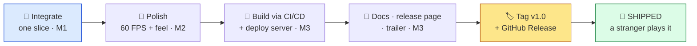
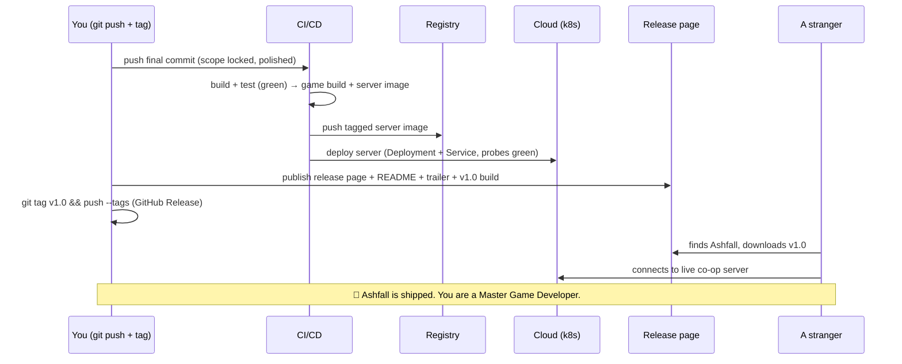

# 👑 Final Boss — Launch Day

| | |
|---|---|
| 🎚️ **Difficulty** | 🔴🔴 Hard |
| ⏱️ **Estimated time** | 240+ minutes |
| ⭐ **XP reward** | 500 |
| 🔓 **Unlocks** | 🎉 Graduation — **Master Game Developer** |

[← Checklist](checklist.md) · [↑ Phase Home](README.md) · [🏠 Back to Home](../../README.md)

---

## 📨 Launch day

```
From:    Theo <theo@pixelforge.studio>
To:      You <new-hire@pixelforge.studio>
Cc:      Maya, Kenji, Lena, Priya <team@pixelforge.studio>

Subject: [W12-BOSS] Today's the day. Ship Ashfall.

It's 9 a.m. and the whole studio is around your desk. Maya brought coffee.
Kenji's grinning. Lena keeps refreshing the trailer. Priya's got the cloud
dashboard up on the big screen. Nobody's pretending to work.

This is the last thing I'll ever ask you to do as a "new hire," because after
today you won't be one. Take Ashfall across the line. Not "almost." Not "for
the demo." SHIPPED — the way a real game ships, to real people, today.

You know the bar. You've known it for a while. No tutorial, no hand-holding,
no copying anything. Just everything you've learned, pointed at one goal:

  - IT'S ONE GAME. Not a folder of systems — a vertical slice that plays start
    to finish: enter a generated dungeon, fight the smart enemies and the
    Warden through its phases, loot, grow, win or lose. One cohesive thing.
  - IT'S POLISHED. A locked 60 FPS, even on the worst frame. Game feel on
    every hit. Audio. A HUD and menus that don't embarrass us. It FEELS done.
  - IT'S LIVE. The co-op server is in the CLOUD, reachable by a stranger, not
    tethered to your laptop. Two people, two machines, one dungeon.
  - IT'S PUBLIC. A release page anyone can find and download. A README that
    tells them how to play. A case study. A trailer that makes them want to.
  - IT'S TAGGED. v1.0, cut clean, with the build attached. The exact thing we
    shipped, frozen in history forever.

When that tag is live and a stranger can play the game, you're done. Not done
with the boss — done with the bootcamp. Done becoming what you came here to be.

Push the button. We'll be right here.

— Theo

P.S. Priya says the billing alarm's armed and the teardown's documented. Of
course it is. You trained her — no wait, she trained you. Either way: ship it.
```

> 👑 **Final Boss rules:** No tutorials, no copying lesson or milestone files wholesale. **Apply** the entire bootcamp. Integrate every system into one vertical slice (M1), polish it to a stable 60 FPS with real game feel and audio (M2), and build + deploy + document + tag it for the public (M3). You win when every victory condition below is met **and a person who is not you can find, download, and play a finished Ashfall** — the co-op server live in the cloud, the release tagged `v1.0`. This is the capstone of twelve worlds. There is no thirteenth.

---

## 🎯 Your mission

**Ship the Ashfall vertical slice: integrated, polished to 60 FPS, deployed live, documented, and tagged `v1.0` — playable by the public.** This is the boss that fuses the entire bootcamp into one launched game.





Win it from these pieces (all of them):

1. **Integrated slice (M1):** every system from W1–W10 assembled into one cohesive run, under one clean architecture, with the feature set locked.
2. **Polished to quality (M2):** a stable **60 FPS** (worst frame under budget), game feel on impacts, finished UX/menus, and audio.
3. **Built via CI/CD (M3):** the final game build and server image come out of the **automated pipeline** (W10), green, no hand-cranking.
4. **Server live in the cloud (M3):** the co-op server **deployed** to the Terraform-defined cluster (W10), health-checked, monitored, reachable by a client that isn't your laptop.
5. **Public + documented (M3):** a **release page** anyone can download from, a complete **README**, a **case study**, and a **trailer**.
6. **Tagged `v1.0` (M3):** a clean git tag and a **GitHub Release** carrying the built artifacts — the exact thing that shipped, frozen.

---

## 🏆 Victory conditions

- [ ] **One vertical slice plays end to end** — start → generated dungeon → smart enemies + the Ashen Warden's phases → loot/grow → win/lose → save, with every system integrated under one clean architecture and the **feature set locked**
- [ ] The slice runs at a **stable 60 FPS** — the *worst* frame stays under the ~16.6 ms budget, not just the average
- [ ] It's **polished**: game feel on impacts (hit-stop/shake/VFX), finished UX (HUD + start/pause/death menus), and **audio** (SFX + music bed)
- [ ] The **final builds come from CI/CD** — green, automated, artifacts produced by the pipeline, not by hand
- [ ] The **co-op server is LIVE in the cloud** — deployed (Deployment + Service, liveness/readiness green), monitored, **reachable by a client that isn't your laptop**; co-op connects across two machines
- [ ] A **public release page** exists (GitHub Release and/or itch.io) where a logged-out stranger can find and **download** the game
- [ ] **Documentation is complete**: a real **README** (what/install/play), a **case study** (what you built + engineering decisions), and a **trailer** (gameplay footage)
- [ ] A **`v1.0` git tag** is cut and a **GitHub Release** carries the built artifacts — and a **person who is not you** has played the shipped game
- [ ] The **billing alarm is armed** and the live server's cost/teardown is documented — shipped safely, not expensively

---

## 🧪 How you'll know you won

```bash
cd ~/projects/ashfall
git tag                       # → v1.0 is there
git log -1 v1.0 --oneline     # → the exact commit you shipped
gh release view v1.0          # → release page + downloadable build artifacts
```

Then run the real test — **a stranger plays your game:**
- **Open the release page logged out** (incognito) — Ashfall is there, with a description, a trailer, and a download that *works on a clean machine*.
- **Play a full run** — enter a generated dungeon, fight enemies that path and sense, beat the Warden through its phases, grab loot, win or lose, and watch the frame-time graph stay flat under 16.6 ms the whole time. It looks and *feels* like a game.
- **Co-op across two machines** — you on one, a friend on another, both connecting to the **cloud** server (not your laptop). One dungeon, two players, synced.
- **Check the pipeline** — the build that's on the release page came out of CI/CD, green, automatically. The server image in the registry is the one running in the cluster.
- **Check the cluster** — `kubectl get deploy,svc,pods` shows the server up, Ready, monitored; the billing alarm is armed and the teardown is written down.
- **Hand it to someone who's never seen it** — the README and trailer are enough for them to install, understand, and play it without asking you a single question.

If a stranger can find, download, and play a polished, 60-FPS, cloud-co-op Ashfall from a `v1.0` release — and you didn't have to be in the room — **you shipped a game.** You won.

<details>
<summary>🔎 What a finished game needs — sketch (only after you've tried!)</summary>

**The shape of a ship (each piece earns its place):**

| Piece | What "done" means | From |
|---|---|---|
| Integrated slice | one run plays start→finish, no orphaned systems, scope locked | M1 / W1–W10 |
| Stable 60 FPS | worst frame < ~16.6 ms; GC/spawns/draws handled | M2 / W7·W9·W10 |
| Game feel + UX + audio | impacts read; menus work; SFX + music; no hitches | M2 / W7 |
| CI/CD final builds | green pipeline produces the game build + server image | M3 / W10 |
| Server live in cloud | Deployment+Service, probes green, monitored, reachable | M3 / W8·W10 |
| Release page + docs | downloadable build, README, case study, trailer | M3 |
| `v1.0` tag + Release | frozen, downloadable, the exact shipped commit | M3 |

**Integrate (M1):**
```text
The slice is the proof, not the breadth. Pick ONE great loop — a single
polished co-op dungeon run that touches every system — and make it whole.
Wire it through the W1 event bus and W9 layered subsystems so nothing is a
special case. Then LOCK it: a v1.1 backlog catches every new idea. Done adding.
```

**Polish (M2):**
```text
Profiler first (W7/W9/W10): find the worst frame, kill the spike (pooling,
batching, no per-frame GC). Then feel: hit-stop on impact, screen shake, the
W7 particles/post stack. Then UX: HUD, start/pause/death/restart menus, clear
feedback. Then audio: SFX on every action + a music/ambience bed (freesound).
"It works" → "it feels done."
```

**Ship (M3):**
```bash
# 1) Final build + server through the pipeline you already trust (W10)
git push                         # CI builds game + server image, green, automatic

# 2) Server live in the cloud (W10: Terraform cluster, k8s Deployment+Service, probes)
terraform apply                  # cluster up · kubectl get pods → Ready · monitored

# 3) Document: README (what/install/play) + case study + trailer (OBS capture)

# 4) Tag the exact thing that shipped, attach the build, publish the page
git tag -a v1.0 -m "Ashfall v1.0 — vertical slice"
git push origin v1.0
gh release create v1.0 ./build/Ashfall-v1.0.zip \
   --title "Ashfall v1.0" --notes-file RELEASE_NOTES.md   # or itch.io

# 5) Prove it: a stranger downloads v1.0, plays a run, joins co-op on the cloud.
#    Then confirm the billing alarm is armed and the teardown is documented.
```

**Why each piece is non-negotiable:**
- **Integration (M1)** is what makes it *a game*, not a tech showcase — a stranger plays one cohesive experience, not your architecture diagram.
- **Polish (M2)** is the gap between "prototype" and "product" — feel and a stable frame are what a player actually perceives.
- **CI/CD + cloud (M3)** is what makes it *shippable and live* — the build is trustworthy and the server outlives your lunch break.
- **Docs + release + tag (M3)** are what make it *reach people* — a frozen, downloadable, understandable thing the world can play without you.

A `v1.0` a stranger can download and play, co-op, against a cloud server, at a locked 60 FPS — that's the entire bootcamp, shipped in one game.
</details>

---

## 🎁 Rewards

- 🏆 **+500 XP**
- 📈 Update [PROGRESS.md](../../PROGRESS.md): mark World 12 ✅ and add the **+250 World Complete bonus**
- 🏅 Achievement unlocked: **🏆 Master Game Developer** — you took Ashfall from an empty Unity project and a `.gitignore` to a shipped, polished, 60-FPS, cloud-co-op vertical slice with full docs and a tagged `v1.0` release the world can play. You didn't just learn to build a game — you learned to **finish** one.
- 🎉 **GRADUATION** — there is no World 13. You've reached the end of the bootcamp.

> 🎓 **Graduation.** Stop for a second and look back at the whole map. Twelve worlds ago you couldn't build an empty scene; today you shipped a game. You learned the game loop and clean architecture, the math of movement, the systems of play, the intelligence of enemies, the look of a lit world, the hard parts of networking and cloud deployment, the discipline of optimization — and the rarest skill of all, the one most people never reach: you **finished and shipped**. Anyone can start a game. You ended one, on a tag, in public, for real players. That's what a **Master Game Developer** is — not someone who knows the most, but someone who *ships*. Ashfall is live. The studio is on its feet. Maya's hugging Kenji, Lena's playing the trailer on loop, Priya's pointing at the green dashboard, and Theo just called you "one of us" — no qualifier, no "junior." Take the win. You earned every pixel of it. 🎉👑
>
> Now go build the next one.

---

[↑ Phase Home](README.md) · [🏠 Back to Home](../../README.md)
