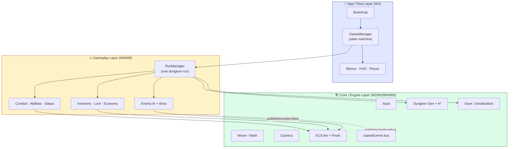
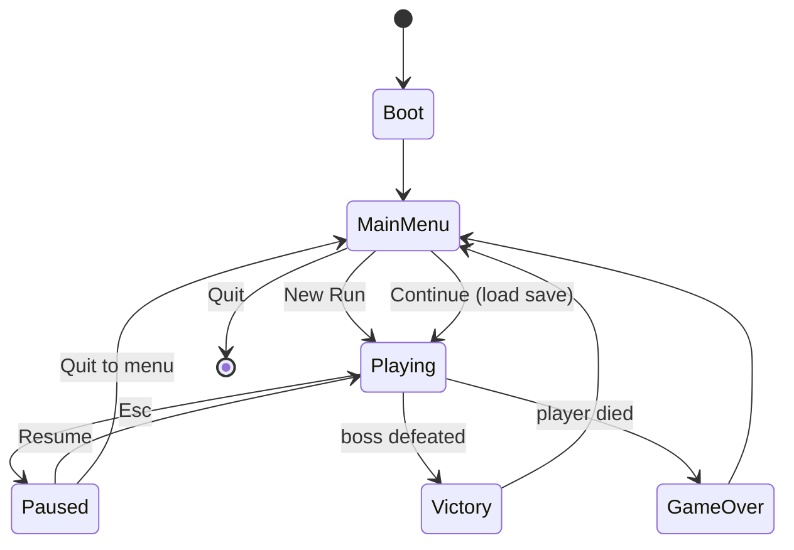

# Level 1 — Milestone: Systems & Architecture

| | |
|---|---|
| 🎚️ **Difficulty** | 🔴 Hard |
| ⏱️ **Estimated time** | A milestone (multi-session) |
| ⭐ **XP reward** | 100 (Quest) + 25 (Quiz) |

[← Prev](../README.md) · [↑ Phase Home](../README.md) · [→ Next](02-milestone-optimization-and-polish.md)

---

## 📖 Story

> *"This is it — the one we put on the storefront. For two years you've built Ashfall piece by piece: clean architecture, the math, the controller, the dungeon, the combat, the AI, the look, co-op, the engine refactor, the cloud pipeline. Every world left a working part. But a pile of working parts is **not a game** — it's a parts bin. A game is those parts wired into **one cohesive loop** that a stranger can pick up, understand in ten seconds, play for ten minutes, lose, and want to try again. That's the job of this first milestone: **integration**. Not new features — we're done adding features. We **lock the scope**, define the **vertical slice** (one polished slice that shows the whole game), and stand it up on the architecture you already learned so it holds together under its own weight. Resist the urge to bolt on 'just one more system.' A shipped slice beats an infinite prototype every time. By the end of this milestone, Ashfall boots to a menu, plays a full run start-to-finish, saves, and is held up by tests — a real game, scoped and structured. Theo's watching the whole studio for this one. Let me show you how to bring it all home. — Kenji"*

---

## 🎯 Goal

- **Lock the vertical-slice scope** for Ashfall — what ships, what's explicitly cut
- Wire every system into **one cohesive game loop**: boot → menu → run → win/lose → menu
- Stand the whole game on the **layered architecture** from W1/W9 (no spaghetti, no god-objects)
- Integrate the **core systems** (W5 gameplay, W6 AI + boss) and supporting layers (W2 math, W3 controller/save, W4 dungeon) into a single playable build
- Add **menus, HUD, pause, and a complete state machine** so it reads as a finished product
- Cover the critical paths with **automated tests** so the slice stays integrated as you polish

---

## 🧠 Concepts

### What "commercial quality" means for *this* milestone

For this milestone it has nothing to do with graphics. It means **structural completeness and integration**:

- **A complete loop with no dead ends.** A player can boot, start, play, reach a real ending (win *or* lose), and return to the menu — never stuck, never crashed, never staring at a missing screen.
- **One architecture, not ten experiments.** Every world taught a pattern; commercial quality is them *agreeing* — managers, events, services, and subsystems composed cleanly, with clear ownership and bootstrap order.
- **Locked scope.** Professionals ship a *defined* thing. A **vertical slice** is the whole game compressed: one biome, a handful of enemies, one boss, the full systems — proof the game *works*, not proof it's *big*.
- **It survives change.** Tests on the critical paths mean the polish pass (Milestone 2) and the deploy (Milestone 3) don't silently break the loop.

### Which worlds this integrates

This milestone is the **convergence point** — almost every world lands here:

| World | What it contributes to the slice |
|---|---|
| W1 — Programming Mastery | Managers, events, interfaces, game-state machine — the skeleton |
| W2 — Math | Movement, aim, smoothing under the controller |
| W3 — Core Game Prog | Input layer, player controller, camera, **save/load** |
| W4 — Algorithms | The dungeon generator + A* that builds each run |
| W5 — Gameplay Systems | Inventory, abilities, combat, status, loot — *the game* |
| W6 — AI | Enemies (FSM/BT/steering) + the Ashen Warden boss |
| W7 — Rendering | The visual layer the loop renders (polished in M2) |
| W9 — Engine Architecture | ECS-lite hot paths, pooling, versioned serialization, layering |

### The final architecture

The whole game is layered — dependencies point **inward/downward only** (gameplay depends on core, never the reverse):



### The game-state machine (no dead ends)

The slice is *complete* precisely because every state has a defined exit:



### Why this exists

This milestone exists because **integration is a distinct discipline, not the absence of work.** Junior engineers believe "the game is done when all the features are done" — but features built in isolation each assume *they* own the update order, the input, the pause behavior, the save format. The first time they run together, those assumptions collide: the menu's input fights the player's, pausing doesn't stop the AI, the boss spawns before the dungeon finishes generating, the save captures half a frame. Wiring them into **one loop on one architecture** is where a parts bin becomes a game, and it's genuinely hard because it surfaces every hidden coupling at once.

**Scope-locking** exists because the opposite — endless feature creep — is the number-one reason indie games never ship. A **vertical slice** is the industry's answer: prove the *entire* experience at small scale so you (and a publisher, or a hiring manager) can see the real game, then decide what to scale. **Tests on the critical paths** exist because integration is fragile: the moment you start polishing and optimizing, you'll refactor, and without tests you'll break the loop without noticing until a player does.

This is **engine-agnostic**. Every shipped game — Unity, Unreal, Godot, or a custom engine — has a flow/state layer over a gameplay layer over a core/engine layer, a defined scope, and (if the team is any good) automated coverage of the paths that must never break. See **RESOURCES.md** for this world (vertical-slice definitions, the "scope is the enemy" talks, and Unity Test Framework / play-mode testing guides).

---

## 🛠️ Hands-on Lab

> 💻 This is a **build plan**, not numbered steps. You already know *how* to build each part — this milestone is about assembling them. Work through the checklists; the sketches show the shape of the integration, not copy-paste code.

### Build Plan A — Lock the scope (do this first, on paper)

Write `docs/SLICE_SCOPE.md` and commit it. A locked scope is a *deliverable*.

- [ ] **One biome / theme** for the slice (e.g. the Ashen Catacombs)
- [ ] **One run length** target (e.g. 8–12 minutes to reach the boss)
- [ ] **Enemy roster:** 3–4 enemy types + **1 boss** (the Ashen Warden) — no more
- [ ] **Player kit:** the controller + ~2 abilities + basic attack + dash
- [ ] **Systems in scope:** inventory, ~6–8 items, loot drops, status effects, gold
- [ ] **The IN / OUT table** — explicitly list what is *cut* (multiplayer is M3's deploy concern; extra biomes; meta-progression). Cutting is the point.

```markdown
## Vertical Slice — IN / OUT
| IN (ships in v1.0)            | OUT (explicitly cut)         |
|-------------------------------|------------------------------|
| 1 biome, 1 boss, 3–4 enemies  | Multiple biomes              |
| Full combat/loot/status loop  | Meta-progression / unlocks   |
| Save/continue, menus, pause   | Settings beyond M2's options |
| Single-player slice           | (Co-op server = M3 deploy)   |
```

### Build Plan B — The flow & state layer (W1)

The spine everything hangs off. Centralize state so pause, save, and UI all read one source of truth.

- [ ] `GameManager` owns a single `GameState` enum (Boot/MainMenu/Playing/Paused/Victory/GameOver)
- [ ] State transitions raise events on the **`GameEvents`** bus; systems react (don't poll)
- [ ] `Bootstrap` scene initializes services in a defined order, then loads MainMenu
- [ ] **Pause** truly freezes the sim (e.g. `Time.timeScale = 0` *and* gate your own ticks) — AI, projectiles, timers all stop

```csharp
public enum GameState { Boot, MainMenu, Playing, Paused, Victory, GameOver }

public class GameManager : MonoBehaviour
{
    public static GameManager I { get; private set; }
    public GameState State { get; private set; }

    public void Set(GameState next)
    {
        if (State == next) return;
        State = next;
        Time.timeScale = (next == GameState.Paused) ? 0f : 1f;
        GameEvents.OnStateChanged?.Invoke(next);   // UI, audio, RunManager react
    }
}
```

### Build Plan C — The run loop (W4 + W5 + W6)

`RunManager` orchestrates a single dungeon run from generation to ending.

- [ ] On **New Run**: pick/seed → generate dungeon (W4) → spawn player at entrance → populate enemies/loot → place boss room
- [ ] On **player death** → `GameManager.Set(GameOver)`; on **boss defeated** → `Set(Victory)`
- [ ] Wire combat/abilities/status/loot (W5) and enemy AI + boss (W6) — they already exist; this is *connecting* them to the run lifecycle and the event bus
- [ ] Guard the **race condition**: nothing spawns or ticks until generation reports complete

```csharp
public class RunManager : MonoBehaviour
{
    public IEnumerator StartRun(int seed)
    {
        yield return Dungeon.Generate(seed);     // W4 — finish FIRST
        Player.SpawnAt(Dungeon.Entrance);        // W3 controller
        Populate(Dungeon.Rooms);                 // W5/W6 enemies + loot
        GameEvents.OnPlayerDied  += () => GameManager.I.Set(GameState.GameOver);
        GameEvents.OnBossDefeated += () => GameManager.I.Set(GameState.Victory);
        GameManager.I.Set(GameState.Playing);
    }
}
```

### Build Plan D — UI & save (W3)

The difference between "a prototype" and "a game" is usually the menus.

- [ ] **Main menu:** New Run · Continue (enabled only if a save exists) · Options (stub for M2) · Quit
- [ ] **HUD:** health, ability cooldowns, currency, mini-objective ("reach the Warden")
- [ ] **Pause menu:** Resume · Quit to menu
- [ ] **Victory / Game Over** screens that return to menu (close the loop!)
- [ ] **Save** captures run + player state via the **versioned** serializer (W9); **Continue** restores it

### Build Plan E — Architecture audit & tests (W1/W9)

Lock it in so it can't drift during polish.

- [ ] Audit: do any two systems reach into each other's internals? Route through **events/interfaces** instead
- [ ] Confirm dependencies point **downward** (gameplay → core, never core → gameplay)
- [ ] **Edit-mode tests:** combat math (damage/armor), loot-table rolls, save serialize→deserialize round-trip
- [ ] **Play-mode test:** the **critical-path smoke test** — boot → start run → kill an enemy → die → back to menu, all without exceptions

```csharp
[Test]  // edit-mode: the rule that must never silently break
public void SaveRoundTrip_PreservesPlayerState()
{
    var before = new SaveData { Hp = 73, Gold = 120, Seed = 42 };
    var json   = SaveSystem.Serialize(before);
    var after  = SaveSystem.Deserialize(json);
    Assert.AreEqual(before.Hp,   after.Hp);
    Assert.AreEqual(before.Gold, after.Gold);
    Assert.AreEqual(before.Seed, after.Seed);
}
```

---

## 🎮 Mini Challenge

A **deterministic "demo seed."** Add a hidden/dev menu option that starts a run with a **fixed seed** so the same dungeon, enemy placement, and loot appear every time. Why is this worth building *now*, before polish?

<details>
<summary>💡 Reveal answer</summary>

A fixed seed gives you a **repeatable scenario** — the same room layout, the same enemies, the same boss approach every run. That's gold for the rest of the project: you can **profile the exact same frame** in Milestone 2 (apples-to-apples before/after optimization numbers), **reproduce bugs** deterministically instead of "it happened once," **record your trailer/GIFs** (M3) on a run you've rehearsed, and **demo confidently** to a hiring manager without RNG embarrassing you. It also proves your generation is genuinely seed-driven (W4) — a hidden test of clean architecture. Build it now because every later milestone *consumes* it. Gate it behind a dev flag so it never ships in the shipped menu.

</details>

---

## 📦 Project Mission

Take Ashfall from "a folder of working systems" to **one cohesive, scoped, playable vertical slice** standing on clean architecture.

1. Write and commit **`docs/SLICE_SCOPE.md`** with the IN/OUT table — scope is *locked*.
2. Implement the **full game-state machine** (Boot → MainMenu → Playing ↔ Paused → Victory/GameOver → MainMenu) with **no dead ends**.
3. Wire **all systems into one run loop** via `RunManager` + the `GameEvents` bus — dungeon (W4), combat/loot/status (W5), AI + boss (W6), controller/camera/save (W2/W3), ECS-lite/pooling (W9).
4. Ship **menus, HUD, pause, victory & game-over** screens.
5. **Save/Continue** works through the versioned serializer.
6. **Audit the architecture** — dependencies point downward, no system reaches into another's internals.
7. Add **tests:** ≥3 edit-mode (combat, loot, save round-trip) + **1 play-mode critical-path smoke test**, all green.
8. Commit on a feature branch and merge:
   ```bash
   cd ~/projects/ashfall
   git switch -c milestone/systems-architecture
   git add docs/SLICE_SCOPE.md Assets/Scripts Assets/Tests
   git commit -m "milestone: integrate full vertical slice on layered architecture + tests"
   git switch main && git merge milestone/systems-architecture && git push
   ```

🎯 **Mission complete when:** a stranger can launch Ashfall, see a **main menu**, start a run, play the **full slice** (dungeon → combat → loot → boss), reach a real **win or lose** ending, **save and continue**, and never hit a dead end or exception — and the **critical-path test is green**. Ashfall is now a *game*, scoped and structured, ready to be made beautiful and fast.

---

## ⚠️ Common Mistakes

| Mistake | What happens | Fix |
|--------|--------------|-----|
| Adding "one more feature" instead of integrating | Slice never converges; you never ship | **Lock scope** in SLICE_SCOPE.md; integrate what exists |
| No real ending | Player wins/dies and is stuck on a frozen screen | Wire **Victory/GameOver → MainMenu**; close the loop |
| Pause doesn't pause everything | AI/projectiles keep running behind the menu | Centralize via `GameManager` state; gate all ticks |
| Spawning before generation finishes | Boss/enemies fall through an unbuilt dungeon | `yield`/await generation **complete** before populate |
| Systems reaching into each other directly | One change breaks five places; spaghetti returns | Communicate via **events/interfaces** (W1) |
| Save written mid-frame / unversioned | Corrupt or unloadable saves after any change | Save at safe points via the **versioned serializer** (W9) |
| No tests on the loop | Polish pass silently breaks the game | **Critical-path smoke test** + core unit tests |

---

## 🤔 Reflection Questions

1. Why is a **vertical slice** a smarter first deliverable than "a bigger but unfinished game"? What does it prove to a hiring manager or publisher that raw feature count doesn't?
2. Your systems all worked in isolation but collided when integrated (input, pause, spawn order, save timing). Which *specific* hidden assumption caused the worst collision in your build, and what architectural pattern resolved it?
3. The lesson insists on tests *before* the polish milestone, not after. Argue why testing the integrated loop is what makes the next two milestones safe to do at all.

---

## 📝 Quiz

1. **A "vertical slice" is…**
   - a) the entire planned game, fully built
   - b) one polished slice that demonstrates the *whole* game's loop at small scope
   - c) a slice of the rendering pipeline only
2. **In a clean layered architecture, dependencies should point…**
   - a) gameplay → core (downward); core never depends on gameplay
   - b) every layer depends on every other layer
   - c) core → gameplay (upward)
3. **Why add a critical-path play-mode test during the integration milestone?**
   - a) to make the build slower
   - b) so the later polish/optimization/deploy work can't silently break the core loop
   - c) tests replace the need for a design

<details>
<summary>✅ Answers</summary>

1: **b** · 2: **a** · 3: **b**

</details>

---

## ✅ Completion Checklist

- [ ] **`docs/SLICE_SCOPE.md`** with a locked IN/OUT table is committed
- [ ] Full **game-state machine** with **no dead ends** (win *and* lose both return to menu)
- [ ] **All systems** wired into one run loop via `RunManager` + event bus
- [ ] **Menus, HUD, pause, victory & game-over** screens exist
- [ ] **Save / Continue** works through the versioned serializer
- [ ] **Architecture audited** — dependencies point downward, no cross-reaching
- [ ] **≥3 edit-mode tests + 1 play-mode critical-path test**, all green
- [ ] A stranger can play the slice **start to finish** without a dead end or exception
- [ ] I passed the quiz
- [ ] Added **+125 XP** to [PROGRESS.md](../../../PROGRESS.md)

---

[← Prev](../README.md) · [↑ Phase Home](../README.md) · [→ Next](02-milestone-optimization-and-polish.md)
