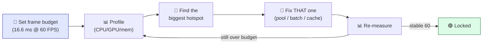
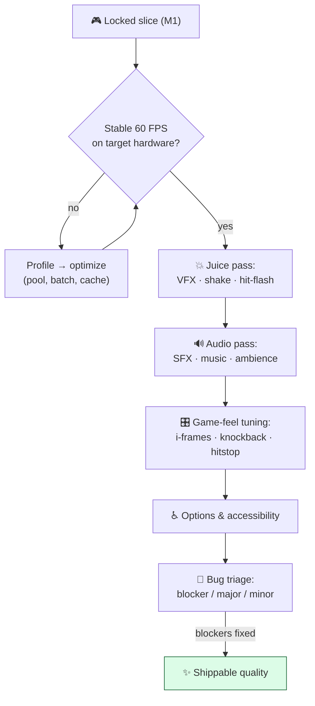

# Level 2 — Milestone: Optimization & Polish

| | |
|---|---|
| 🎚️ **Difficulty** | 🔴 Hard |
| ⏱️ **Estimated time** | A milestone (multi-session) |
| ⭐ **XP reward** | 100 (Quest) + 25 (Quiz) |

[← Prev](01-milestone-systems-and-architecture.md) · [↑ Phase Home](../README.md) · [→ Next](03-milestone-build-deploy-and-document.md)

---

## 📖 Story

> *"Okay — it *works*. I played your slice end to end, didn't get stuck once. Now we make it feel like a **product**. Here's the secret nobody tells you: the gap between 'a student project' and 'a game I'd buy' is almost never *more features* — it's **performance and polish.** A game that stutters reads as broken even when the code is perfect. A hit with no flash, no shake, no sound reads as *nothing happened*. So this milestone is two passes that run together. First, **optimization**: we profile — measure, don't guess — and lock a stable **60 FPS** frame budget, because smooth is a feature you feel before you can name it. Second, **the juice and atmosphere pass** — Lena's been waiting for this — lighting, particles, screen shake, audio, game-feel tuning until every hit, dash, and death *lands*. And we make it **accessible**: options, remappable controls, a few toggles, so more people can actually enjoy it. Then I want a real **bug triage** — every game has bugs; pros decide *which ones ship*. Make it fast, make it feel incredible, make it kind to play. When you're done, Ashfall won't just function — it'll *shine.* Let me show you. — Kenji (with Lena on VFX)"*

---

## 🎯 Goal

- **Profile first** — measure CPU/GPU/memory; find real hotspots before changing anything (W10/W9)
- Lock a **stable 60 FPS** within a defined frame budget; kill GC spikes and frame hitches
- Do the full **juice & atmosphere pass** (W7): lighting, particles, post-processing, screen shake, hit-flash
- Layer in **audio** — SFX on every meaningful action + music/ambience
- **Tune game feel** — i-frames, knockback, camera, hitstop, input responsiveness until it *lands*
- Add **accessibility & options** — settings menu, remappable input, key toggles
- Run a real **bug triage** and fix the ship-blockers

---

## 🧠 Concepts

### What "commercial quality" means for *this* milestone

If Milestone 1 was *does it work*, this milestone is *does it feel like a real game.* That's two measurable things:

- **It's smooth.** A stable, consistent frame rate is the single biggest signal of quality a player feels subconsciously. **Consistency beats peak** — a steady 60 feels better than a stuttery 120. You hit it by **measuring**, not guessing.
- **It has juice.** "Juice" is the layer of feedback — visual, audio, motion — that makes actions feel powerful and the world feel alive. The same hit, with a flash + shake + crunch sound + particles + a 40 ms hitstop, goes from "a number changed" to "I *hit* that."
- **It's kind.** Accessibility and options (remap keys, toggle shake, adjust volume/difficulty) mean more people can finish your game — and it signals professional craft.
- **It's triaged.** Commercial quality isn't *zero* bugs; it's *no ship-blocking* bugs and a known list of the rest.

### Which worlds this integrates

| World | What it contributes to this milestone |
|---|---|
| W10 — Production Eng | **Profiling** (the profiler, frame budget, finding hotspots) |
| W9 — Engine Architecture | Pooling + ECS-lite + DOD hot paths to *hit* the budget; GC elimination |
| W7 — Rendering | Lighting, shaders (hit-flash/dissolve), particles, post-processing, screen shake — the juice |
| W3 — Core Game Prog | Input layer → **remappable controls**; camera tuning |
| W2 — Math | Easing/lerp for smooth camera, knockback, hitstop timing |
| W5 — Gameplay | Game-feel tuning of combat (i-frames, knockback, cooldown feel) |

### Measure → optimize → re-measure (never guess)

The cardinal rule of optimization. You profile to find the *real* hotspot, fix only that, then re-measure to confirm:



> The 60 FPS frame budget is **16.6 ms per frame** — *everything* (input, AI, physics, gameplay, render) must fit. Profiling tells you who's eating it.

### The polish (ship-readiness) flow

Optimization and polish are passes over the locked slice — they change *how it feels*, never *what it is*:



### Bug triage — deciding what ships

Every shipped game has bugs. The professional act is **classifying** them and fixing only what must be fixed:

- **Blocker** — crashes, soft-locks, save corruption, can't finish a run. **Must fix before ship.**
- **Major** — breaks a system or badly hurts feel (boss skippable, ability does nothing). **Fix if at all possible.**
- **Minor / cosmetic** — a particle in the wrong spot, a typo. **Log it; ship it; fix later.**

### Why this exists

This milestone exists because **"it works" and "it's good" are different problems with different methods.** Performance exists as its own discipline because players feel a dropped frame *before* they can articulate it — a stutter at the wrong moment reads as a broken game, so smoothness isn't a nice-to-have, it's the substrate everything else sits on. And the iron law is **measure first**: human intuition about what's slow is *reliably wrong*, so we profile to find the real hotspot instead of "optimizing" code that was never the problem (and risking new bugs for zero gain). That's exactly why W9's pooling and DOD and W10's profiler exist — to *hit* a budget you've actually measured.

**Juice** exists because games communicate through feedback, and an action with no reaction reads as no action at all — the flash, shake, sound, and hitstop are how the game tells the player "that mattered." It's cheap to add and transforms perceived quality more than almost anything else. **Accessibility and options** exist because a game only succeeds if people can actually play it — remappable controls and a few toggles are the minimum respect you pay your players, and they're table stakes in the industry. **Triage** exists because chasing *zero* bugs is how games never ship; the skill is deciding, on evidence, which bugs are allowed to exist at launch.

This is **engine-agnostic**. Every engine has a profiler and a frame budget; every shipped game does a juice pass, an audio pass, a game-feel tuning pass, an options menu, and a triage. The principles — measure before optimizing, feedback on every action, ship with a known bug list — are universal craft. See **RESOURCES.md** for this world (Steve Swink's *Game Feel*, the classic "Juice it or lose it" / "secrets of game feel" talks, free SFX on freesound, and your engine's profiler docs).

---

## 🛠️ Hands-on Lab

> 💻 A **build plan**, not numbered steps. Use the **deterministic demo seed** from M1's mini-challenge for *every* before/after measurement — same scene, honest numbers.

### Build Plan A — Profile & lock 60 FPS (W10/W9)

Measure before you touch anything. Optimize the *biggest* offender, re-measure, repeat.

- [ ] Set the target: **60 FPS = 16.6 ms/frame**. Decide your target hardware (e.g. your laptop).
- [ ] Capture a baseline with the profiler on the **demo seed** — note CPU ms, GPU ms, GC allocs/frame, draw calls
- [ ] Find the top hotspot (usually one of: per-frame **allocations** → GC spikes; **draw calls** → batching; an O(n²) loop; unpooled spawns)
- [ ] Apply the *right* fix: **object pooling** for bullets/enemies/VFX (W9), **batching/atlasing** sprites (W7), cache lookups, move work off the hot path
- [ ] **Re-measure on the same seed.** Record the before/after in `docs/PERF.md`
- [ ] Watch **frame-time consistency**, not just average FPS — hunt the spikes

```csharp
// The #1 cause of game-feel-killing hitches: per-frame heap allocations → GC.
// Pool everything that spawns in the hot path (W9). NO `new` in Update/OnHit.
var fx = VfxPool.Get(PoolId.HitSpark);   // reuse, don't allocate
fx.transform.position = hitPoint;
fx.Play();
// ...returns itself to the pool on finish — zero GC, zero hitch.
```

### Build Plan B — The juice & atmosphere pass (W7)

Make every meaningful action *land*. Add feedback in layers.

- [ ] **Hit-flash** shader on damaged entities (W7) + **damage numbers**
- [ ] **Particles** on impact, dash, pickup, death (dissolve) — pooled
- [ ] **Screen shake** on hits/boss slams (small! tie magnitude to impact, ease it out — W2)
- [ ] **Hitstop** — freeze ~30–60 ms on a solid hit; it sells weight more than anything
- [ ] **Lighting & post** — torch/player lights, bloom, vignette; tune for *atmosphere* (Ashen mood), keep it in budget
- [ ] **Boss telegraphs** read clearly (the Warden's attacks are *fair* because they're readable)

### Build Plan C — Audio pass

Silence reads as "broken." Sound is half of game feel.

- [ ] **SFX** on every meaningful action: attack, hit, dash, pickup, ability, enemy death, boss phase, UI clicks
- [ ] **Music** — a loop for menu and for the run + a boss track (free sources, see RESOURCES.md)
- [ ] **Ambience** — a low dungeon bed so the world feels alive
- [ ] A simple **audio bus / mixer** so volumes are controllable (feeds the options menu)

### Build Plan D — Game-feel tuning (W5/W3/W2)

Tune, playtest, repeat. This is dials, not new code.

- [ ] **Combat:** i-frames after taking damage, knockback weight, cooldown *feel*, attack responsiveness
- [ ] **Camera:** follow smoothing, a touch of look-ahead, shake intensity (W2 easing)
- [ ] **Input:** snappy, no perceptible lag; buffer the attack/dash a few frames so inputs never feel "eaten"
- [ ] Playtest the **demo seed** repeatedly — does the *moment-to-moment* feel good?

### Build Plan E — Options & accessibility (W3)

The professional minimum. Build the settings menu M1 stubbed.

- [ ] **Audio sliders** (master/music/SFX) wired to the mixer
- [ ] **Remappable controls** via the input layer (W3) — at least the core actions
- [ ] **Toggles:** screen shake on/off, fullscreen/windowed, resolution
- [ ] **Persist** settings (save them; load on boot)
- [ ] Bonus accessibility: a colorblind-safe palette check, an "easier" combat toggle, readable font sizes

### Build Plan F — Bug triage

- [ ] Maintain `docs/BUGS.md` with a **Blocker / Major / Minor** table
- [ ] Playtest the full slice deliberately trying to break it; log everything
- [ ] **Fix all blockers**, fix majors if you can, ship minors with the list documented

```markdown
## Ashfall — Bug Triage
| ID | Severity | Bug                              | Status   |
|----|----------|----------------------------------|----------|
| 1  | Blocker  | Soft-lock if boss dies mid-dash  | FIXED    |
| 2  | Major    | Poison ignores i-frames          | FIXED    |
| 3  | Minor    | Pickup sparkle 1px off           | Won't fix (ship) |
```

---

## 🎮 Mini Challenge

**Hitstop.** Add a tiny time-freeze (~40 ms) on a solid hit — both attacker and target pause for a few frames, then resume. It's a handful of lines. Why does such a small thing make combat feel so much more powerful, and what's the one trap to avoid?

<details>
<summary>💡 Reveal answer</summary>

Hitstop works because the brief freeze gives your brain a **moment to register the impact** — it punctuates the hit, separating "before" and "after" so the collision reads as *force* rather than two sprites overlapping. Pair it with the flash + shake + crunch sound and a normal hit suddenly feels *heavy*. It's the single highest feel-per-line-of-code change you can make.

**The trap:** don't implement it with `Time.timeScale = 0` if that also freezes your UI, audio, or the hitstop coroutine itself — you'll deadlock the freeze. Use a **scaled, self-restoring** approach (a short coroutine on unscaled time, or briefly lower `timeScale` and restore it after `WaitForSecondsRealtime`), and **keep it tiny** — 30–60 ms. Too long and the game feels laggy instead of punchy. Also scale magnitude to impact: light hits get little or none, the boss slam gets the full freeze.

</details>

---

## 📦 Project Mission

Take the *working* slice from M1 and make it **fast, juicy, and kind** — shippable quality.

1. **Profile** on the demo seed; record baseline in `docs/PERF.md`. Lock a **stable 60 FPS** by fixing real, measured hotspots (pooling/batching/caching). Record before/after.
2. **Juice pass:** hit-flash, impact/death/dash particles, screen shake, **hitstop**, lighting + post — all pooled, all in budget.
3. **Audio pass:** SFX on every meaningful action + menu/run/boss music + ambience, through a mixer.
4. **Game-feel tuning:** i-frames, knockback, camera, input buffering — playtested on the demo seed.
5. **Options menu:** audio sliders, **remappable controls**, shake/fullscreen toggles, **persisted**.
6. **Bug triage:** `docs/BUGS.md` with severity table; **all blockers fixed**.
7. Re-run the M1 **critical-path test** — still green after all this change.
8. Commit and merge:
   ```bash
   cd ~/projects/ashfall
   git switch -c milestone/optimization-polish
   git add docs/PERF.md docs/BUGS.md Assets
   git commit -m "milestone: lock 60 FPS, full juice+audio pass, options/a11y, triage"
   git switch main && git merge milestone/optimization-polish && git push
   ```

🎯 **Mission complete when:** Ashfall holds a **stable 60 FPS** on the demo seed (with `PERF.md` before/after to prove it), **every hit feels great** (flash + shake + hitstop + sound), there's **audio on every meaningful action + music**, an **options menu with remappable controls** that persists, **zero ship-blocking bugs** (triaged in `BUGS.md`), and the **critical-path test is still green**. Ashfall doesn't just run — it *shines*.

---

## ⚠️ Common Mistakes

| Mistake | What happens | Fix |
|--------|--------------|-----|
| Optimizing by guessing | You "fix" code that wasn't slow; real hotspot remains | **Profile first**; fix the measured top offender; re-measure |
| Chasing peak FPS over consistency | 120 avg but stutters; feels worse than steady 60 | Hunt **frame-time spikes**; target *stable* 60 |
| `new` in the hot path | GC spikes → recurring hitches | **Pool** bullets/enemies/VFX (W9); zero hot-path allocs |
| No feedback on actions | Hits read as "nothing happened" | Layer **flash + shake + hitstop + sound + particles** |
| Screen shake / hitstop overdone | Nauseating, laggy feel | Keep tiny; scale to impact; **let players toggle shake** |
| No options / non-remappable input | Players can't play comfortably; reads as amateur | Settings menu + **remappable controls**, persisted |
| Trying to fix *every* bug | Game never ships | **Triage**: fix blockers, ship a documented minor list |

---

## 🤔 Reflection Questions

1. "Measure before you optimize." Describe a time in this milestone you *expected* the slowdown to be one thing and the profiler proved otherwise. What would guessing have cost you?
2. Take one action in Ashfall (a sword hit, the dash, the boss slam) and break down every feedback layer you added — visual, audio, motion, time. Which single layer added the most *perceived* power per line of code, and why?
3. You shipped with a known list of minor bugs. Defend that decision as professional rather than lazy. Where exactly is the line between a "ship it" minor and a "must fix" blocker?

---

## 📝 Quiz

1. **The first step when a game runs below its frame budget is to…**
   - a) rewrite the slowest-*looking* code from memory
   - b) **profile** to find the real, measured hotspot, then fix *that*
   - c) lower the resolution and hope
2. **"Juice" in game feel refers to…**
   - a) extra gameplay features and levels
   - b) the layer of visual/audio/motion **feedback** that makes actions feel impactful
   - c) the game's color saturation only
3. **Professional bug triage means…**
   - a) fixing every bug, no matter how small, before shipping
   - b) classifying bugs by severity and fixing the **ship-blockers**, shipping a documented minor list
   - c) ignoring all bugs until after launch

<details>
<summary>✅ Answers</summary>

1: **b** · 2: **b** · 3: **b**

</details>

---

## ✅ Completion Checklist

- [ ] **Stable 60 FPS** on the demo seed, with **`docs/PERF.md`** before/after numbers
- [ ] Hot-path **allocations eliminated** (pooled VFX/bullets/enemies)
- [ ] **Juice pass:** hit-flash, particles, screen shake, **hitstop**, lighting/post — in budget
- [ ] **Audio pass:** SFX on every meaningful action + music + ambience via a mixer
- [ ] **Game-feel tuning** done (i-frames, knockback, camera, input buffering)
- [ ] **Options menu:** audio sliders, **remappable controls**, shake/fullscreen toggles, **persisted**
- [ ] **`docs/BUGS.md`** triage table; **all blockers fixed**
- [ ] M1 **critical-path test still green**
- [ ] I passed the quiz
- [ ] Added **+125 XP** to [PROGRESS.md](../../../PROGRESS.md)

---

[← Prev](01-milestone-systems-and-architecture.md) · [↑ Phase Home](../README.md) · [→ Next](03-milestone-build-deploy-and-document.md)
