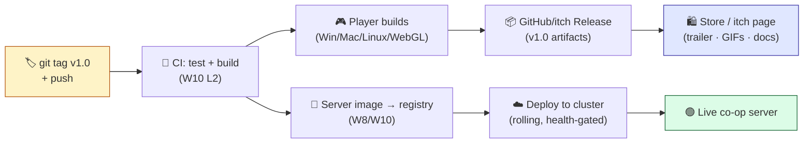
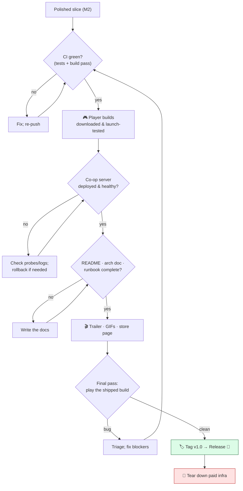

# Level 3 — Milestone: Build, Deploy & Document

| | |
|---|---|
| 🎚️ **Difficulty** | 🔴 Hard |
| ⏱️ **Estimated time** | A milestone (multi-session) |
| ⭐ **XP reward** | 100 (Quest) + 25 (Quiz) |

[← Prev](02-milestone-optimization-and-polish.md) · [↑ Phase Home](../README.md) · [→ Next](../boss-battle.md)

---

## 📖 Story

> *"Theo here. I'll keep this short because what you've built speaks for itself. Ashfall is whole, it's fast, it feels incredible. There's exactly one thing left, and it's the thing that separates people who *make games* from people who *ship games*: **getting it into someone else's hands.** A build sitting on your laptop has helped zero players and impressed zero hiring managers. So this final milestone is about **release**. Produce real **player builds** through the CI/CD pipeline Priya helped you set up — so the build is reproducible, not 'it worked on my machine.' Deploy the **co-op dedicated server** to the cloud so two people anywhere can play together. Then — and listen, because engineers always skip this — **present it like a product.** A store page that sells the fantasy in five seconds. A trailer and GIFs that show, don't tell. And the **documentation** that proves you're a professional: a README anyone can run, an architecture doc that explains your thinking, and a runbook for the live server. Finally, you **tag `v1.0`** and you ship. The whole studio will be in the room. This is your launch day. Make it count. Let me show you how we land the plane. — Theo (Studio Director)"*

---

## 🎯 Goal

- Produce **player builds** (Win/Mac/Linux or WebGL) through the **W10 CI/CD pipeline** — reproducible, on push
- **Deploy the co-op dedicated server** to the cloud via the W10 image → registry → cluster pipeline (free tier; tear down after)
- Build a compelling **store / itch-style page** that sells the game fast
- Create a **trailer + GIFs** for the page and your portfolio
- Write **full documentation**: README (run it), architecture doc (explain it), runbook (operate it)
- **Tag `v1.0`** and cut a real **release** — Ashfall is shipped

---

## 🧠 Concepts

### What "commercial quality" means for *this* milestone

This is the milestone where Ashfall stops being *your* project and becomes *a product other people experience.* Commercial quality here means:

- **Reproducible builds.** The release artifact comes from **CI on a clean machine**, tied to a commit — not a manual export from your laptop that nobody can reproduce.
- **Available to play.** Player builds people can download *and* a live co-op server they can connect to — the game actually runs for someone who isn't you.
- **Presented, not just dumped.** A store page, trailer, and GIFs that communicate the game in seconds. Marketing is part of the craft; an unmarketed game is an invisible one.
- **Documented to professional standard.** README, architecture doc, and runbook — the artifacts that let *anyone* run, understand, and operate the project. This is what a hiring manager actually reads.
- **Versioned & released.** A `v1.0` tag and a release page — a frozen, named thing you can point to forever.

### Which worlds this integrates

| World | What it contributes to the release |
|---|---|
| W10 — Production Eng | **CI/CD** (automated builds + tests on push) → player build artifacts |
| W8 + W10 | The **Dockerized co-op server** → registry → **cloud cluster** deploy |
| W10 — Operate | Health checks, monitoring, **runbook** for the live server |
| W1/W9 — Architecture | The **architecture doc** explaining the layered design you built |
| W7 + M2 — Polish | The visuals/feel that make a **trailer/GIFs** worth watching |
| All worlds | The README's "built with" story — the whole journey, summarized |

### The release pipeline

One push produces the player build *and* updates the live server — the full automation from W10, now used for real:



### The ship checklist flow

Releasing is a gated sequence — each gate must pass before the next. This is the launch-day discipline:



### The three documents that prove you're a professional

Different readers, different docs — don't merge them:

- **README** — *for someone who wants to run it.* What it is, screenshots/GIF, how to install/play, how to build from source, controls, credits. The front door.
- **Architecture doc** — *for an engineer (or hiring manager) who wants to understand your thinking.* The layered design, key patterns (events, ECS-lite, state machine), the architecture diagram, and the *why* behind your decisions. This is what gets you hired.
- **Runbook** — *for whoever operates the live server.* How to deploy, check health, read logs, roll back, and tear down (straight from W10). Proves you think past "it shipped."

### Why this exists

This milestone exists because **a game that no one can play has, by definition, failed at the only thing games are for** — and the gap between "done on my machine" and "in a stranger's hands" is enormous and entirely skippable, which is exactly why so many projects die one step from the finish line. **CI/CD builds** exist because "it worked on my laptop" is not a release process: a reproducible build tied to a commit is the difference between an artifact you can trust and ship and one you can only pray over. **Deploying the server** exists because co-op only means anything if two people who aren't in the same room can connect — the cloud is what makes "multiplayer" true rather than theoretical.

The **store page, trailer, and GIFs** exist because attention is the scarcest resource in games: a brilliant game no one notices is indistinguishable from a game that doesn't exist, so presenting it well is not vanity, it's the job. And the **documentation** exists because your code will outlive your memory of it, will be read by people who can't ask you questions, and — bluntly — is the single most-scrutinized thing in a job application: a clean README and a thoughtful architecture doc tell a hiring manager more about your seniority than the code itself. Finally the **`v1.0` tag** exists because shipping must be a *decision* — a named, frozen point you commit to — not an endless "almost done."

This is **engine- and platform-agnostic professional practice.** Every shipped game everywhere goes through reproducible builds, a deploy (or distribution) step, a marketing surface, documentation, and a versioned release. The tools differ (itch.io vs Steam vs the App Store; GitHub Actions vs Jenkins; EKS vs a game-hosting service) but the shape is universal. See **RESOURCES.md** for this world (itch.io publishing, free trailer/GIF capture tools, README/architecture-doc templates, semantic versioning, and the W10 CI/CD + cloud links — **free tier only; keep your billing alarm and tear infra down**).

---

## 🛠️ Hands-on Lab

> 💻 A **build plan**, not numbered steps. Reuse the **W10 CI/CD + cloud pipeline** — this milestone *applies* it for a real release. 🚨 **Cost safety: free tier only.** Keep your **$1 billing alarm**, and `terraform destroy` / stop instances the moment your demo is captured.

### Build Plan A — Player builds via CI (W10)

The artifact people download must come from the pipeline, not a manual export.

- [ ] CI builds player binaries on push/tag (extend the W10 Actions workflow) — at least one platform; **WebGL** is great for an instant in-browser itch demo
- [ ] CI runs the **test suite** (M1's critical-path test included) — **build only if green**
- [ ] CI uploads the build as a **release artifact**
- [ ] **Download the CI build on a clean machine and actually launch it** — never ship an artifact you haven't run

```yaml
# .github/workflows/release.yml (sketch — extends the W10 CI)
on:
  push:
    tags: ['v*']                 # release on a version tag
jobs:
  build:
    runs-on: ubuntu-latest
    steps:
      - uses: actions/checkout@v4
      - name: Test                # gate: must pass to build
        run: ./ci/run-tests.sh
      - name: Build player (WebGL + desktop)
        run: ./ci/build-players.sh
      - name: Publish release
        uses: softprops/action-gh-release@v2
        with: { files: build/** }   # attach artifacts to the v1.0 release
```

### Build Plan B — Deploy the co-op server (W8 + W10)

The live service. Reuse your image → registry → cluster → health-check pipeline.

- [ ] CI builds & pushes the **server image** (SHA-tagged) to the registry
- [ ] Deploy to the cluster with **rolling update + liveness/readiness probes** (W10 L5)
- [ ] Verify two clients can **connect and play co-op** against the live server
- [ ] Confirm **monitoring + one alert** are live; the **runbook** covers it
- [ ] Note the connect address in the README (or gate co-op behind a "join server" field)

### Build Plan C — The store / itch page

Sell the fantasy in five seconds. This is a real skill — practice it.

- [ ] **One-line hook** ("A 2D top-down roguelite where every run burns down to the Ashen Warden")
- [ ] **Trailer** at the top (Build Plan D), then **GIFs** of the best moments
- [ ] Short **feature bullets** (juicy combat, procedural runs, a real boss, co-op)
- [ ] **Download links** (the CI builds) + WebGL "Play in browser" if you have it
- [ ] Controls, credits (free assets — attribute them!), system requirements

### Build Plan D — Trailer & GIFs

Show, don't tell. Capture on the **demo seed** so it's rehearsed and clean.

- [ ] Record 30–60 s of the best gameplay (free capture tools — RESOURCES.md)
- [ ] Cut a tight trailer: hook → combat → boss → logo. Music from M2.
- [ ] Export 3–5 looping **GIFs** of standout moments (a juicy kill, the dash, the boss) for the page + your portfolio README

### Build Plan E — The three documents

- [ ] **`README.md`** — what it is, a GIF, install/play, build-from-source, controls, credits
- [ ] **`docs/ARCHITECTURE.md`** — the layered design + the M1 architecture **Mermaid diagram**, key patterns, and *why* you chose them
- [ ] **`docs/RUNBOOK.md`** — deploy, health-check, logs, rollback, **teardown** (from W10)

```markdown
# Ashfall  ·  v1.0
> A 2D top-down action-roguelite. Burn through the Ashen Catacombs to the Warden.

## Play           ## Build from source        ## Architecture
- Download ↓      - `git clone … && open …`   - See docs/ARCHITECTURE.md
- Or play (Web)   - CI builds on tag          ## Credits — free assets (attributed)
```

### Build Plan F — Tag, release, tear down

- [ ] Final pass: **play the shipped build** end to end (the ship-checklist `Verify` gate)
- [ ] **Tag `v1.0`** — CI produces the release artifacts automatically
- [ ] Publish the **release** + the **store page**
- [ ] 🚨 **Tear down paid cloud infra** once your demo/trailer is captured — bill back to $0

```bash
cd ~/projects/ashfall
git switch main
git pull
# Ship it. The tag triggers the release pipeline (Build Plan A/B):
git tag -a v1.0 -m "Ashfall vertical slice — v1.0 🚀"
git push origin v1.0
# After capturing the live demo/trailer — stop the bill:
cd infra && terraform destroy      # or stop/delete the cluster + instances
```

---

## 🎮 Mini Challenge

You've got 60 seconds of someone's attention on your itch page. **Storyboard your trailer's first 5 seconds.** What plays, and why is the *opening* the most important part of the whole release?

<details>
<summary>💡 Reveal answer</summary>

The first 5 seconds decide whether anyone watches the other 55 — viewers bounce in the first beat, so you **lead with your strongest, most legible gameplay moment**, not a logo or a slow fade-in. A great opening: a fraction of a second of context (the player in the dungeon), then **immediately** the juiciest thing you built — a hit-flash + screen-shake + hitstop kill, or the boss slamming in — with the audio punch from M2 landing on frame. No long title card, no studio splash hogging the open (put the logo at the *end*). The principle is **"show the verb"**: in 5 seconds a stranger should understand what they *do* in your game and feel that it looks good to do it. This is exactly why M1's deterministic demo seed and M2's juice pass mattered — you're now harvesting them. It mirrors store-page craft (hook in one line) and even a résumé (lead with your best work). Hook first; everything else is detail.

</details>

---

## 📦 Project Mission

**Ship Ashfall.** Take the polished slice from M2 and release it to the world — builds, server, page, docs, and a `v1.0` tag.

1. **Player builds via CI:** the W10 pipeline builds player binaries (+ WebGL ideally) **only when tests pass**, and uploads them as release artifacts. **Download and launch-test** the CI build on a clean machine.
2. **Deploy the co-op server** to the cloud (image → registry → cluster, health-gated). Verify **two clients play co-op live**. (Free tier; tear down after.)
3. **Store / itch page:** hook line, trailer, GIFs, feature bullets, download/play links, controls, credits.
4. **Trailer + 3–5 GIFs** captured on the demo seed.
5. **Three documents:** `README.md`, `docs/ARCHITECTURE.md` (with the architecture diagram + the *why*), `docs/RUNBOOK.md`.
6. **Tag `v1.0`** and publish the release.
7. 🚨 **Tear down paid infra** after capturing the demo — bill at $0.

🎯 **Mission complete when:** Ashfall is **released at `v1.0`** — player builds come from **green CI** and you've launched one yourself; the **co-op server is deployed and two people can play live**; there's a **store page with a trailer + GIFs**; **README, architecture doc, and runbook** are written to professional standard; and **paid infra is torn down** (bill at $0). Ashfall is shipped. The bootcamp's flagship is *done.* 🚀

---

## ⚠️ Common Mistakes

| Mistake | What happens | Fix |
|--------|--------------|-----|
| Manual build from your laptop | Not reproducible; "works on my machine" | Build via **CI on a clean runner**, tied to the tag |
| Shipping a build you never launched | Broken release in players' hands | **Download the CI artifact and run it** before release |
| Deploying without health checks | Co-op silently down; you find out from players | **Probes + monitoring + runbook** (W10 L5) |
| No trailer/GIFs, just a code dump | Nobody plays it; reads as a hobby project | **Trailer + GIFs + store page** — show, don't tell |
| One giant README for everything | Nobody finds what they need | **Three docs:** README (run) · architecture (understand) · runbook (operate) |
| "Almost done" forever | Never ships | **Tag `v1.0`** — make shipping a decision |
| Leaving cloud infra running | Surprise bill | `terraform destroy` / stop instances; keep the **$1 alarm** |

---

## 🤔 Reflection Questions

1. Why is a build produced by **CI on a clean machine** fundamentally more trustworthy than the same build exported manually from your laptop — even if they look identical? What can the CI build catch that yours can't?
2. The README, the architecture doc, and the runbook serve three different readers. For a hiring manager skimming your repo in two minutes, which one earns you the job, and what specifically should it say?
3. "Shipping must be a decision, not a state you drift into." Why does tagging `v1.0` — committing to a frozen point — matter psychologically and professionally, even though the game will always have things you'd still want to improve?

---

## 📝 Quiz

1. **The release build should be produced by…**
   - a) a manual export from your laptop right before launch
   - b) **CI on a clean machine**, gated on passing tests, tied to the version tag
   - c) whichever teammate's machine is free
2. **The document most likely to get you hired when a manager skims your repo is the…**
   - a) `.gitignore`
   - b) **architecture doc** (and a clean README) — it shows your engineering thinking
   - c) the bug list
3. **After capturing your live co-op demo on free-tier cloud, you should…**
   - a) leave it running indefinitely so it's always available
   - b) **tear down the paid infra** (`terraform destroy` / stop instances) and keep the billing alarm
   - c) upgrade to a paid plan

<details>
<summary>✅ Answers</summary>

1: **b** · 2: **b** · 3: **b**

</details>

---

## ✅ Completion Checklist

- [ ] **Player builds** come from **green CI** (tests gate the build); I **launch-tested** the artifact
- [ ] **Co-op server deployed** to the cloud, health-gated; **two clients played live**
- [ ] **Store / itch page** with hook, trailer, GIFs, links, controls, credits
- [ ] **Trailer + 3–5 GIFs** captured on the demo seed
- [ ] **`README.md`**, **`docs/ARCHITECTURE.md`** (with diagram + *why*), **`docs/RUNBOOK.md`** written
- [ ] **Tagged `v1.0`** and published the release
- [ ] 🚨 **Paid infra torn down** — bill at $0
- [ ] I passed the quiz
- [ ] Added **+125 XP** to [PROGRESS.md](../../../PROGRESS.md)

---

[← Prev](02-milestone-optimization-and-polish.md) · [↑ Phase Home](../README.md) · [→ Next](../boss-battle.md)
